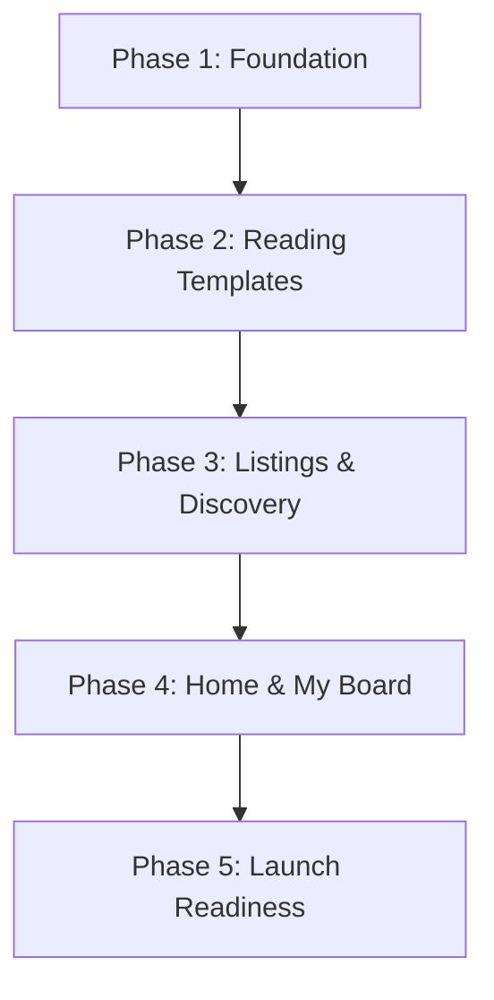

# Roadmap & Phase Plan: Udyam Manch (उद्यम मंच)

This roadmap outlines the 5-phase delivery plan defined in Section 12 of the PRD. Each phase has explicit scopes, deliverables, requirement mappings, and exit criteria.

---

## Overview of Phases

---

## Phase 1: Foundation & Infrastructure (Critical Path)
**Goal**: Establish the decoupled modern platform architecture, headless CMS backend, data models, authentication with RBAC, and deployment pipeline.

- **Scope**:
  1. Select and initialize the stack (Next.js App Router + Headless CMS / Content Layer).
  2. Implement data schemas:
     - `FounderJourney` & `Story`
     - `Founder` (person profile)
     - `Company` (directory entry)
     - `Category` & `Tag`
     - `TeamMember` / User Roles (`Writer`, `Editor`, `Admin`)
  3. Set up role-based access control and admin dashboard authentication.
  4. Configure media asset storage pipeline with automatic WebP/AVIF compression.
  5. Establish CI/CD deployment pipeline with preview environments and HTTPS custom domain setup.
- **Requirements Covered**: REQ-ADM-01, REQ-ADM-05, REQ-ADM-11, REQ-NFR-04, REQ-NFR-05.
- **Exit Criteria**:
  - [ ] Non-technical team member can log in and view dashboard.
  - [ ] All 5 schemas are deployed with relations working (Story -> Founder/Company).
  - [ ] Image uploads are automatically compressed and served from CDN.
  - [ ] Staging and Production deployment pipeline active.

---

## Phase 2: Reading Templates & Social Previews (Critical Path)
**Goal**: Deliver the high-fidelity, magazine-grade reading templates with server-rendered preview cards and social sharing features.

- **Scope**:
  1. Build unified Reading Template for Founder Journeys (`/founders/[slug]`) and Stories (`/stories/[slug]`).
  2. Implement Company Facts Panel for Founder Journeys.
  3. Implement layout variants (Full-width cover vs Side-by-side editorial cover).
  4. Develop sticky & inline Share Bar (WhatsApp, LinkedIn, X, Facebook, Native Share Sheet, Copy Link toast).
  5. Integrate server-side dynamic Open Graph & Twitter Card generator (1200x630 branded cards).
  6. Add JSON-LD `NewsArticle` / `BlogPosting` structured data and canonical links.
  7. Implement 404 behavior for draft/unpublished slugs and 301 redirect engine for changed slugs.
- **Requirements Covered**: REQ-TMP-01 through REQ-TMP-12, REQ-SEO-01 through REQ-SEO-07, REQ-NFR-01, REQ-NFR-02, REQ-NFR-03.
- **Exit Criteria**:
  - [ ] Reading template matches editorial typography (*Bricolage Grotesque* & *Newsreader*) across desktop & mobile.
  - [ ] Pasting a test URL into WhatsApp, LinkedIn, and X displays 100% correct title, dek, and 1200x630 image.
  - [ ] Share buttons work with correct tracking parameters (`?utm_source=...`).
  - [ ] Draft items return 404 to unauthenticated visitors.

---

## Phase 3: Listings & Discovery System
**Goal**: Transform static catalog listings into high-performance, dynamic feeds with multi-faceted filtering, search, and directory company profiles.

- **Scope**:
  1. Build dynamic `/founders` listing with Featured Founder hero slot, industry/city/year filters, and search.
  2. Build dynamic `/stories` listing with Category tabs, tag filtering, featured story slot, and chronological feed.
  3. Build dynamic Category page (`/stories/category/[slug]`).
  4. Build interactive Startup Directory (`/directory`) and Company Profile pages (`/directory/[slug]`) pulling linked stories.
  5. Build static informational pages (`/get-featured`, `/about`, `/contact`).
  6. Implement performant pagination / virtualized "Load More" handling hundreds of records without lag.
- **Requirements Covered**: REQ-PUB-01 through REQ-PUB-13, REQ-SEO-08, REQ-NFR-01, REQ-NFR-06.
- **Exit Criteria**:
  - [ ] Filter by industry, city, and year filters instantly without layout shift.
  - [ ] Search returns accurate matches for founder and company names within 100ms.
  - [ ] Company profile displays all associated stories and founder profiles.
  - [ ] Mobile 2-column pinboard layout renders smoothly on 360px-430px viewports.

---

## Phase 4: Dynamic Home & Robust "My Board"
**Goal**: Wire the homepage to live CMS data and re-architect "My Board" to use permanent slug-based pins that gracefully tolerate content state changes.

- **Scope**:
  1. Connect Homepage (`/`) to CMS endpoints for featured slots, latest stories, and company spotlight.
  2. Migrate "My Board" from fragile prototype index IDs to canonical slug identifiers.
  3. Implement silent unpinning: if a pinned item is unpublished, it is removed from the user's board quietly without errors.
  4. Implement real-time board counter badge in navigation header.
  5. Implement board export/shareable token link and local browser storage persistence.
  6. Ensure guided walkthrough and spotlight tour integrate cleanly with dynamic components.
- **Requirements Covered**: REQ-PUB-14 through REQ-PUB-20, REQ-NFR-02, REQ-NFR-03.
- **Exit Criteria**:
  - [ ] Home page renders fresh published content automatically upon CMS publish.
  - [ ] Pinned items retain valid bookmarks even when article title is updated.
  - [ ] Unpublishing an article quietly purges it from the reader's board.
  - [ ] Walkthrough tour functions without blocking keyboard or mobile navigation.

---

## Phase 5: Launch Readiness & Operational Handover
**Goal**: Complete editorial team onboarding, end-to-end preview validation, accessibility/performance sign-off, and production launch.

- **Scope**:
  1. Seed initial batch of real curated founder journeys, stories, and company directory entries.
  2. Conduct editorial onboarding test: Non-technical team member publishes 3-photo story in < 15 mins.
  3. Validate social preview caching and document WhatsApp pre-share verification checklist.
  4. Comprehensive audit: WCAG 2.2 AA accessibility test, Core Web Vitals audit (LCP < 2s on 4G), and security penetration test (no public write, strict image size).
  5. Domain cutover, HTTPS verification, sitemap submission to Google Search Console.
- **Requirements Covered**: REQ-ADM-04, REQ-ADM-06, REQ-ADM-07, REQ-ADM-12, REQ-NFR-01 through REQ-NFR-06.
- **Exit Criteria**:
  - [ ] Editorial team publishes without engineer assistance.
  - [ ] Lighthouse score: Performance 95+, Accessibility 100, Best Practices 100, SEO 100.
  - [ ] Acceptance summary criteria from PRD Section 14 fully checked off.
